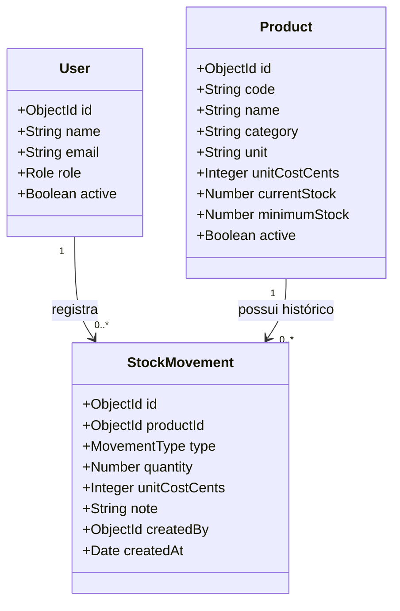
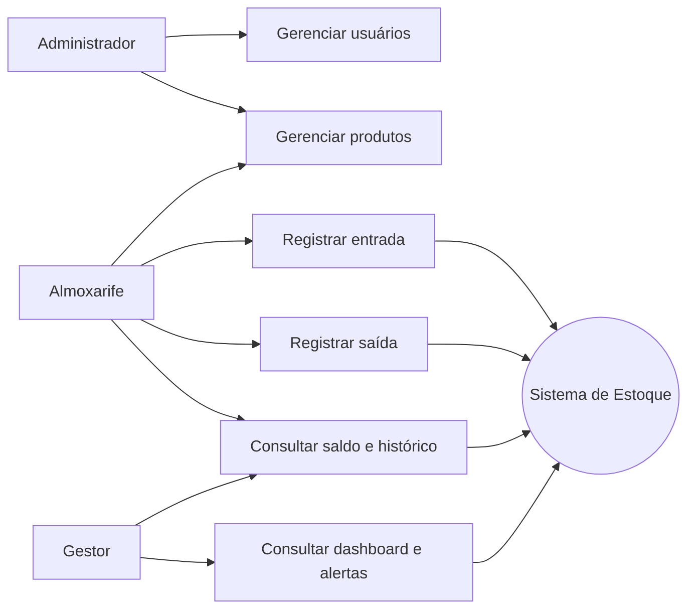
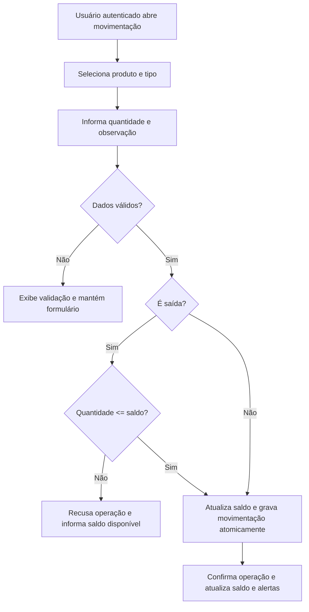

# DevSolutions — Controle de Estoque

## 1. Visão do projeto

**Cliente:** Almoxarifado Central Ltda.  
**Objetivo:** substituir planilhas por um sistema interno que mantenha o saldo confiável, registre entradas e saídas e indique o que precisa ser reposto.

### Situação da implementação neste workspace

O workspace não possui a base Next.js/MongoDB descrita no cenário. A solução foi adaptada ao projeto Flutter existente em `ApiWebService/json_todo_list_path`, usando Firebase Authentication e Cloud Firestore. Ela cobre login, cadastro/recuperação de conta, dados sincronizados por conta, produtos, movimentações atômicas, bloqueio de saldo negativo, alertas, dashboard e importação do JSON local. Contas distintas ainda não compartilham um único almoxarifado nem possuem papéis/convites; isso requer uma próxima etapa de gestão multiusuário.

### Público-alvo

- **Administrador:** gerencia usuários, produtos e configurações.
- **Almoxarife:** cadastra produtos e registra entradas e saídas.
- **Gestor:** consulta saldos, alertas e indicadores do estoque.

### Premissas

- O sistema é de uso interno e exige autenticação.
- Cada movimentação se refere a um único produto e possui quantidade positiva.
- O saldo é atualizado a partir de movimentações registradas; não há edição direta do saldo.
- Valores monetários são armazenados em centavos para evitar erros de arredondamento.
- A base Next.js mencionada no enunciado não foi localizada no workspace. Esta especificação assume Next.js, MongoDB, JWT e bcrypt conforme o briefing; a implementação deve ser conectada à base correta quando ela estiver disponível.

## 2. Escopo do MVP

### Incluído

1. Login e logout de usuários autorizados.
2. Cadastro, consulta, edição e desativação de produtos.
3. Pesquisa por nome ou código e filtro por categoria.
4. Registro de entrada e saída com quantidade, data e observação.
5. Consulta do saldo atual e histórico de movimentações por produto.
6. Configuração de estoque mínimo e alerta de reposição.
7. Dashboard com valor estimado do estoque e produtos mais movimentados.
8. Registro do usuário responsável por cada movimentação.

### Fora do escopo inicial

- Compra automatizada e integração com fornecedores.
- Leitura de código de barras, emissão de notas fiscais e integração contábil.
- Múltiplos depósitos, transferência entre unidades e estoque reservado.
- Aplicativo móvel offline e notificações externas.

## 3. Requisitos

### Requisitos funcionais

| ID | Requisito | Critério de aceite |
|---|---|---|
| RF-01 | Autenticar usuários | Credenciais válidas abrem o sistema; inválidas não revelam se o usuário ou a senha está incorreto. |
| RF-02 | Gerenciar produtos | Usuário autorizado cadastra, consulta, edita e desativa produtos com nome, código único, categoria, unidade, preço unitário e estoque mínimo. |
| RF-03 | Consultar estoque | A lista exibe saldo atual; busca e filtro permitem localizar produtos. |
| RF-04 | Registrar entrada | Quantidade positiva aumenta o saldo e cria uma movimentação rastreável. |
| RF-05 | Registrar saída | Quantidade positiva reduz o saldo; a operação é recusada se exceder o saldo disponível. |
| RF-06 | Consultar histórico | O detalhe do produto lista entradas e saídas em ordem cronológica, com quantidade, data, responsável e observação. |
| RF-07 | Alertar reposição | Produtos com saldo menor ou igual ao mínimo configurado são destacados como “baixo estoque”. |
| RF-08 | Exibir dashboard | Apresenta valor estimado do estoque e produtos com maior movimentação no período selecionado. |
| RF-09 | Controlar acesso | Ações de administração ficam restritas a usuários com perfil administrador. |

### Requisitos não funcionais

- Senhas armazenadas exclusivamente como hash bcrypt; nunca registrar senha em logs.
- Endpoints autenticados validam sessão/token e autorização no servidor.
- Validação de entrada tanto no cliente quanto na API.
- Atualização do saldo e criação da movimentação devem ser atômicas para evitar divergência.
- Registrar datas em UTC e apresentá-las no fuso local da empresa.
- Interface responsiva, com mensagens claras para erros, carregamento e listas vazias.
- Desativar produto não apaga seu histórico de movimentações.

## 4. Modelo de dados proposto

### `User`

| Campo | Tipo | Regras |
|---|---|---|
| `_id` | ObjectId | Identificador |
| `name` | string | Obrigatório |
| `email` | string | Obrigatório, único |
| `passwordHash` | string | Hash bcrypt |
| `role` | enum | `admin`, `operator` ou `viewer` |
| `active` | boolean | Padrão `true` |

### `Product`

| Campo | Tipo | Regras |
|---|---|---|
| `_id` | ObjectId | Identificador |
| `code` | string | Obrigatório, único |
| `name` | string | Obrigatório |
| `category` | string | Obrigatório |
| `unit` | string | Ex.: unidade, caixa, pacote |
| `unitCostCents` | integer | Não negativo |
| `currentStock` | number | Não negativo; atualizado somente pelo fluxo de movimentação |
| `minimumStock` | number | Não negativo |
| `active` | boolean | Padrão `true` |
| `createdAt`, `updatedAt` | date | Auditoria |

### `StockMovement`

| Campo | Tipo | Regras |
|---|---|---|
| `_id` | ObjectId | Identificador |
| `productId` | ObjectId | Referência a `Product` |
| `type` | enum | `entry` ou `exit` |
| `quantity` | number | Maior que zero |
| `unitCostCents` | integer | Custo registrado na entrada; opcional na saída |
| `note` | string | Observação opcional, limite de tamanho definido pela API |
| `createdBy` | ObjectId | Referência ao usuário autenticado |
| `createdAt` | date | Data da movimentação |

### Diagrama de classes



## 5. Casos de uso



## 6. Fluxo de movimentação



## 7. Protótipo de baixa fidelidade

```text
┌────────────────────────────────────────────────────────────────┐
│ DevSolutions / Estoque                    Usuário    [Sair]     │
├───────────────┬────────────────────────────────────────────────┤
│ Visão geral   │ Estoque                                         │
│ Produtos      │ [Buscar por nome ou código...] [Categoria ▾]    │
│ Movimentações │                                                  │
│               │ [ + Novo produto ]       [ + Movimentação ]     │
│               │                                                  │
│               │ Produto     Código   Saldo   Mínimo   Situação  │
│               │ Papel A4    P-001    12 cx   5 cx     Normal    │
│               │ Caneta azul C-004    3 un    10 un    Repor     │
│               │ ...                                              │
└───────────────┴────────────────────────────────────────────────┘
```

### Dashboard

```text
┌────────────────────────────────────────────────────────────────┐
│ Visão geral                            Período [Últimos 30 dias]│
├───────────────────┬───────────────────┬────────────────────────┤
│ Itens cadastrados │ Valor do estoque  │ Abaixo do mínimo       │
│       128         │     R$ 8.420,00   │          7             │
├─────────────────────────────────┬──────────────────────────────┤
│ Produtos mais movimentados      │ Estoque baixo               │
│ Papel A4       42 movimentações │ Caneta azul      3 / mín. 10 │
│ Toner preto    18 movimentações │ Pasta suspensa   2 / mín. 5  │
└─────────────────────────────────┴──────────────────────────────┘
```

## 8. API sugerida

| Método | Rota | Ação |
|---|---|---|
| `POST` | `/api/auth/login` | Autenticar |
| `POST` | `/api/auth/logout` | Encerrar sessão |
| `GET` | `/api/products` | Listar, buscar e filtrar produtos |
| `POST` | `/api/products` | Cadastrar produto |
| `GET` | `/api/products/:id` | Consultar produto e saldo |
| `PATCH` | `/api/products/:id` | Editar ou desativar produto |
| `GET` | `/api/products/:id/movements` | Consultar histórico |
| `POST` | `/api/movements` | Registrar entrada ou saída |
| `GET` | `/api/dashboard` | Consultar indicadores e alertas |

O endpoint de movimentação deve validar o usuário, produto ativo, tipo e quantidade. Para saída, deve impedir saldo negativo. A gravação da movimentação e a alteração do saldo precisam ocorrer na mesma transação; caso o MongoDB usado não ofereça transações na configuração escolhida, implementar controle concorrente seguro e documentar a limitação.

## 9. Riscos e mitigação

| Risco | Impacto | Mitigação |
|---|---|---|
| Saldo divergente por alterações simultâneas | Alto | Atualização atômica/condicional do saldo junto da movimentação; teste de concorrência. |
| Saída maior que o saldo | Alto | Validar no servidor no momento da gravação, não apenas na interface. |
| Movimentação duplicada por reenvio | Médio | Desabilitar envio repetido no cliente e usar chave de idempotência quando aplicável. |
| Exclusão indevida de dados históricos | Alto | Desativar produtos e preservar movimentações; restringir exclusões administrativas. |
| Acesso não autorizado | Alto | JWT em cookie `HttpOnly`, `Secure` em produção, política `SameSite`, verificação de papel no servidor e expiração adequada. |
| Custo de estoque interpretado incorretamente | Médio | Definir no MVP o cálculo como saldo atual × custo unitário atual e informar que é estimativa. |
| Dados iniciais inconsistentes na migração de planilhas | Médio | Validar códigos duplicados, quantidades negativas e unidades antes da importação. |

## 10. Plano de testes e critérios de conclusão

- **Produtos:** cadastro válido, código duplicado, campos obrigatórios, edição e desativação.
- **Entradas:** soma correta do saldo e histórico associado ao usuário.
- **Saídas:** subtração correta; recusa ao tentar retirar mais do que existe.
- **Integridade:** erro ao gravar movimentação não pode deixar o saldo parcialmente atualizado.
- **Alertas:** saldo igual ou inferior ao mínimo aparece como baixo estoque.
- **Dashboard:** valor total confere com a soma de saldo × custo; ranking respeita o período escolhido.
- **Autorização:** usuário sem sessão não acessa API protegida; perfil de consulta não movimenta estoque.
- **Interface:** estados de carregamento, erro, vazio e sucesso são compreensíveis em tela estreita e larga.

O MVP está pronto para demonstração quando os fluxos de autenticação, cadastro, entrada, saída, alerta e dashboard funcionarem integrados ao banco, com validação dos critérios acima.
